# Plotting reference

Everything a figure can show and every setting that changes how it looks.
This file is written by `scripts/make_plotting_docs.py` from the settings in
`src/spectrum_toolkit/style.py`, so it always lists every setting
(389 today). Edit the script, not this file.

## How to use settings

**Python:** give any setting by name to a plot, on top of a style preset:
```python
c.plot(style="publication", top_tick_length=8, xlabel_color="blue")
stk.set_style("matlab", legend_box=True)      # default for every later plot
stk.save_style("matlab", "my_style", box_width=2)   # reuse with style="my_style.json"
```

**Website (`/figure`):** the same names go in `"settings"`:
```json
{"kind": "lines", "style": "publication", "settings": {"top_tick_length": 8, "xlabel_color": "blue"}, "data": {...}}
```
`/options` lists every setting with its default and meaning, so the website
can build its controls from it.

**Saved styles on the website (`/style-check`):** a style file saved with
`stk.save_style` (or by the website) is sent as its contents, never as a file
name: the service opens no files. `"style"` is a preset name or a dict:
```json
{"style": {"preset": "publication", "line_width": 1.5}, "settings": {"legend_box": true}}
```
The answer has `"style"` (every setting, ready to save as `my_style.json` and to
load again on the website or in Python with `style="my_style.json"`),
`"changed"` (only the settings that differ from the defaults) and `"warnings"`
(fonts not installed on the server). A wrong setting gives the same message as
in Python.

A wrong name or value is an error that says what is allowed, for example
`tick_alpha is a transparency from 0 (invisible) to 1 (solid); got 2.`

## Presets

`clean` (default), `publication`, `matlab`, `matplotlib`; see the top of
`style.py` for what each sets. Every setting below can be changed on top.

## The naming rule

The last word of a setting name always means the same:

| Ending | Meaning | Values |
|---|---|---|
| `_color` | colour | see **Colours** below |
| `_alpha` | transparency | 0 (invisible) to 1 (solid) |
| `_width` | line width | points (1 point = 1/72 inch) |
| `_style` | line type | `"-"` solid, `"--"` dashed, `":"` dotted, `"-."` dash-dot |
| `_size` | text or marker size | points |
| `_weight` | text thickness | `"normal"` or `"bold"` |
| `_italic` | slanted text | true / false |
| `_font` | font name | e.g. `"Arial"`, `"Times New Roman"`; falls back if not installed |
| `_length` | tick length | points |
| `_pad` | distance to the next element | points |
| `_rotation` | text angle | degrees, e.g. 45 or 90 |

## From general to specific

Many settings exist at three levels. The most specific one that is set wins:

1. **one side**: `top_tick_length`, `left_box_color`, `right_tick_label_color` ...
2. **one axis**: `x_tick_length` (bottom and top), `y_tick_color` (left and right), `xlabel_size` ...
3. **everything**: `tick_length`, `box_color`, `label_size` ...

A setting that is *(not set)* uses the next level. So `tick_length: 6` makes
every tick 6 points long, `x_tick_length: 8` then changes the bottom and top
ticks, and `top_tick_length: 10` only the top ones.

## Colours

Every colour setting accepts any of these:

| Form | Example |
|---|---|
| name | `"red"`, `"navy"`, `"tab:blue"` |
| hex | `"#1f77b4"` |
| grey (0 black to 1 white) | `"0.5"` |
| RGB, fractions 0-1 | `[0, 0.45, 0.74]` |
| RGB, 0-255 | `[0, 114, 189]` |
| RGBA (with transparency) | `[0, 0.45, 0.74, 0.5]` |
| CMYK, fractions or percent | `"cmyk(0, 0.5, 1, 0)"`, `"cmyk(0, 50, 100, 0)"` |
| no colour (backgrounds, fills) | `"none"` |

CMYK colours are converted to RGB for drawing; to save the whole figure as a
CMYK file use `color_mode="cmyk"` with tiff or jpg (see **Saving**).

## Figure size and shape

| Setting | Default | What it does |
|---|---|---|
| `size` | "screen" | figure size: a name in SIZES or (width, height) in "units" |
| `units` | "cm" | "cm" or "in" for size |
| `aspect` | *(not set)* | plot area shape: None (fills the figure), "square", or height/width e.g. 0.75 |

## Axis limits

`x_range` and `y_range` fix the ends of an axis; `null` (None) on one side
leaves that end automatic, e.g. `"y_range": [0, null]` starts at zero. Use
them to give several figures the same scale, or to cut off one huge band so
the small ones show. The order of the two numbers does not matter, and
`invert_x` still decides the direction. `region` (a plot argument) picks an
x part and fits y to the data inside it; `y_range`, when set, wins over that
fit. A band cut off by `y_range` keeps its peak label, moved down to the top
of the box. The margins set the white space where an end is automatic.

| Setting | Default | What it does |
|---|---|---|
| `x_range` | *(not set)* | x axis limits [lo, hi]; either may be None (automatic); the direction follows invert_x |
| `y_range` | *(not set)* | y axis limits [lo, hi]; either may be None (automatic), e.g. [0, None] to start at 0 |
| `x_margin` | 0.05 | automatic white space left and right of the data, as a fraction of its width (0 = the data touches the box) |
| `y_margin` | 0.05 | automatic white space below and above the data, as a fraction of its height |

![y_range [0, 0.5] cuts off the tall bands so the small ones show; their peak labels stay at the top of the box. x_margin 0: the spectra touch the box left and right.](plotting/axis_limits.png)

*y_range [0, 0.5] cuts off the tall bands so the small ones show; their peak labels stay at the top of the box. x_margin 0: the spectra touch the box left and right.*

Python:
```python
c.plot(y_range=[0, 0.5], x_margin=0, peaks=4)
```
Website (`/figure`), next to `"data"`:
```json
{"peaks": 4, "settings": {"y_range": [0, 0.5], "x_margin": 0}}
```


## Text: the base for all text

| Setting | Default | What it does |
|---|---|---|
| `font` | "sans-serif" | font name for all text, e.g. "Arial", "Times New Roman"; falls back if not installed |
| `font_size` | 10 | base text size in points (tick labels use it unless tick_label_size is set) |
| `font_weight` | "normal" | "normal" or "bold": all text unless a more specific _weight is set |

## Box (the lines around the plot)

General:

| Setting | Default | What it does |
|---|---|---|
| `box` | "open" | "closed" (all four sides), "open" (left and bottom) or "none" |
| `box_width` | 0.8 | box line width in points |
| `box_color` | "black" | box line colour |
| `box_alpha` | 1.0 | box line transparency, 0 to 1 |
| `box_style` | "-" | box line type: "-", "--", ":" or "-." |
| `background` | "white" | figure background colour (around the plot); "none" for transparent |
| `background_alpha` | 1.0 | figure background transparency, 0 to 1 |
| `plot_background` | *(not set)* | background colour inside the box; None = background |
| `plot_background_alpha` | *(not set)* | transparency inside the box, 0 to 1; None = background_alpha |

One side (`bottom`, `top`, `left`, `right`); each falls back to the general setting:

| Setting | Default | What it does |
|---|---|---|
| `bottom_box` | *(not set)* | box line on the bottom side: true or false; None = box |
| `bottom_box_width` | *(not set)* | box_width for the bottom side only; None = box_width |
| `bottom_box_color` | *(not set)* | box_color for the bottom side only; None = box_color |
| `bottom_box_alpha` | *(not set)* | box_alpha for the bottom side only; None = box_alpha |
| `bottom_box_style` | *(not set)* | box_style for the bottom side only; None = box_style |
| `top_box` | *(not set)* | box line on the top side: true or false; None = box |
| `top_box_width` | *(not set)* | box_width for the top side only; None = box_width |
| `top_box_color` | *(not set)* | box_color for the top side only; None = box_color |
| `top_box_alpha` | *(not set)* | box_alpha for the top side only; None = box_alpha |
| `top_box_style` | *(not set)* | box_style for the top side only; None = box_style |
| `left_box` | *(not set)* | box line on the left side: true or false; None = box |
| `left_box_width` | *(not set)* | box_width for the left side only; None = box_width |
| `left_box_color` | *(not set)* | box_color for the left side only; None = box_color |
| `left_box_alpha` | *(not set)* | box_alpha for the left side only; None = box_alpha |
| `left_box_style` | *(not set)* | box_style for the left side only; None = box_style |
| `right_box` | *(not set)* | box line on the right side: true or false; None = box |
| `right_box_width` | *(not set)* | box_width for the right side only; None = box_width |
| `right_box_color` | *(not set)* | box_color for the right side only; None = box_color |
| `right_box_alpha` | *(not set)* | box_alpha for the right side only; None = box_alpha |
| `right_box_style` | *(not set)* | box_style for the right side only; None = box_style |

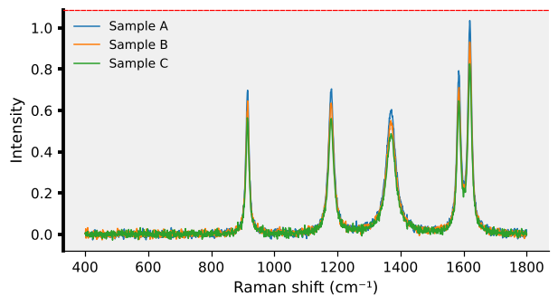

*Box set per side: thick left line, dashed red top line, no right line; light grey inside the box.*

Python:
```python
c.plot(box='closed', left_box_width=2.5, top_box_color='red', top_box_style='--', right_box=False, plot_background='0.94', grid=False)
```
Website (`/figure`), next to `"data"`:
```json
{"settings": {"box": "closed", "left_box_width": 2.5, "top_box_color": "red", "top_box_style": "--", "right_box": false, "plot_background": "0.94", "grid": false}}
```


## Ticks and tick labels

**Which sides** have tick marks and numbers: `tick_sides` and
`tick_label_sides` (lists), or one side at a time with `bottom_ticks`,
`top_tick_labels` ... (true / false).

General:

| Setting | Default | What it does |
|---|---|---|
| `tick_direction` | "out" | "in", "out" or "both" (through the box line); old name: ticks |
| `tick_length` | 4.0 | tick length in points |
| `tick_width` | *(not set)* | tick width in points; None = box_width |
| `tick_color` | *(not set)* | tick colour; None = box_color |
| `tick_alpha` | 1.0 | tick transparency, 0 to 1 |
| `tick_sides` | ["bottom", "left"] | sides with ticks: any of "bottom", "top", "left", "right" |
| `tick_label_sides` | ["bottom", "left"] | sides with tick labels (numbers): any of "bottom", "top", "left", "right" |
| `tick_label_size` | *(not set)* | tick label (number) size in points; None = font_size |
| `tick_label_color` | "black" | tick label colour |
| `tick_label_alpha` | 1.0 | tick label transparency, 0 to 1 |
| `tick_label_weight` | *(not set)* | "normal" or "bold"; None = font_weight |
| `tick_label_italic` | false | tick labels in italics: true or false |
| `tick_label_font` | *(not set)* | tick label font; None = font |
| `tick_label_rotation` | 0 | tick label rotation in degrees, e.g. 45 or 90 |
| `tick_label_pad` | 3.5 | distance between tick and tick label, in points |
| `minor_ticks` | false | small ticks between the numbered ones: true or false |
| `minor_tick_length` | *(not set)* | minor tick length in points; None = 0.55 x tick_length |
| `minor_tick_count` | *(not set)* | number of minor ticks between two numbered ticks; None = automatic |
| `x_ticks_at` | *(not set)* | x tick positions, e.g. [400, 800, 1200, 1600]; None = automatic |
| `y_ticks_at` | *(not set)* | y tick positions, e.g. [0, 0.5, 1]; None = automatic |
| `x_tick_step` | *(not set)* | distance between x ticks, e.g. 200; None = automatic |
| `y_tick_step` | *(not set)* | distance between y ticks, e.g. 0.25; None = automatic |
| `x_tick_count` | *(not set)* | about how many numbered x ticks, e.g. 5 (rounded to good numbers); None = automatic |
| `y_tick_count` | *(not set)* | about how many numbered y ticks, e.g. 4 (rounded to good numbers); None = automatic |
| `x_tick_format` | *(not set)* | number format of x tick labels, e.g. "%.0f"; None = automatic |
| `y_tick_format` | *(not set)* | number format of y tick labels, e.g. "%.2f"; None = automatic |

One axis (`x_` = bottom and top, `y_` = left and right); each falls back to the general setting:

| Setting | Default | What it does |
|---|---|---|
| `x_tick_direction` | *(not set)* | tick_direction for the x axis only; None = tick_direction |
| `x_tick_length` | *(not set)* | tick_length for the x axis only; None = tick_length |
| `x_tick_width` | *(not set)* | tick_width for the x axis only; None = tick_width |
| `x_tick_color` | *(not set)* | tick_color for the x axis only; None = tick_color |
| `x_tick_alpha` | *(not set)* | tick_alpha for the x axis only; None = tick_alpha |
| `x_tick_label_size` | *(not set)* | tick_label_size for the x axis only; None = tick_label_size |
| `x_tick_label_color` | *(not set)* | tick_label_color for the x axis only; None = tick_label_color |
| `x_tick_label_alpha` | *(not set)* | tick_label_alpha for the x axis only; None = tick_label_alpha |
| `x_tick_label_weight` | *(not set)* | tick_label_weight for the x axis only; None = tick_label_weight |
| `x_tick_label_italic` | *(not set)* | tick_label_italic for the x axis only; None = tick_label_italic |
| `x_tick_label_font` | *(not set)* | tick_label_font for the x axis only; None = tick_label_font |
| `x_tick_label_rotation` | *(not set)* | tick_label_rotation for the x axis only; None = tick_label_rotation |
| `x_tick_label_pad` | *(not set)* | tick_label_pad for the x axis only; None = tick_label_pad |
| `x_minor_ticks` | *(not set)* | minor_ticks for the x axis only; None = minor_ticks |
| `x_minor_tick_length` | *(not set)* | minor_tick_length for the x axis only; None = minor_tick_length |
| `x_minor_tick_count` | *(not set)* | minor_tick_count for the x axis only; None = minor_tick_count |
| `y_tick_direction` | *(not set)* | tick_direction for the y axis only; None = tick_direction |
| `y_tick_length` | *(not set)* | tick_length for the y axis only; None = tick_length |
| `y_tick_width` | *(not set)* | tick_width for the y axis only; None = tick_width |
| `y_tick_color` | *(not set)* | tick_color for the y axis only; None = tick_color |
| `y_tick_alpha` | *(not set)* | tick_alpha for the y axis only; None = tick_alpha |
| `y_tick_label_size` | *(not set)* | tick_label_size for the y axis only; None = tick_label_size |
| `y_tick_label_color` | *(not set)* | tick_label_color for the y axis only; None = tick_label_color |
| `y_tick_label_alpha` | *(not set)* | tick_label_alpha for the y axis only; None = tick_label_alpha |
| `y_tick_label_weight` | *(not set)* | tick_label_weight for the y axis only; None = tick_label_weight |
| `y_tick_label_italic` | *(not set)* | tick_label_italic for the y axis only; None = tick_label_italic |
| `y_tick_label_font` | *(not set)* | tick_label_font for the y axis only; None = tick_label_font |
| `y_tick_label_rotation` | *(not set)* | tick_label_rotation for the y axis only; None = tick_label_rotation |
| `y_tick_label_pad` | *(not set)* | tick_label_pad for the y axis only; None = tick_label_pad |
| `y_minor_ticks` | *(not set)* | minor_ticks for the y axis only; None = minor_ticks |
| `y_minor_tick_length` | *(not set)* | minor_tick_length for the y axis only; None = minor_tick_length |
| `y_minor_tick_count` | *(not set)* | minor_tick_count for the y axis only; None = minor_tick_count |

One side; each falls back to the axis setting, then the general one:

| Setting | Default | What it does |
|---|---|---|
| `bottom_ticks` | *(not set)* | ticks on the bottom side: true or false; None = tick_sides |
| `bottom_tick_labels` | *(not set)* | tick labels on the bottom side: true or false; None = tick_label_sides |
| `bottom_tick_direction` | *(not set)* | tick_direction for the bottom side only; None = x_tick_direction |
| `bottom_tick_length` | *(not set)* | tick_length for the bottom side only; None = x_tick_length |
| `bottom_tick_width` | *(not set)* | tick_width for the bottom side only; None = x_tick_width |
| `bottom_tick_color` | *(not set)* | tick_color for the bottom side only; None = x_tick_color |
| `bottom_tick_alpha` | *(not set)* | tick_alpha for the bottom side only; None = x_tick_alpha |
| `bottom_tick_label_size` | *(not set)* | tick_label_size for the bottom side only; None = x_tick_label_size |
| `bottom_tick_label_color` | *(not set)* | tick_label_color for the bottom side only; None = x_tick_label_color |
| `bottom_tick_label_alpha` | *(not set)* | tick_label_alpha for the bottom side only; None = x_tick_label_alpha |
| `bottom_tick_label_weight` | *(not set)* | tick_label_weight for the bottom side only; None = x_tick_label_weight |
| `bottom_tick_label_italic` | *(not set)* | tick_label_italic for the bottom side only; None = x_tick_label_italic |
| `bottom_tick_label_font` | *(not set)* | tick_label_font for the bottom side only; None = x_tick_label_font |
| `bottom_tick_label_rotation` | *(not set)* | tick_label_rotation for the bottom side only; None = x_tick_label_rotation |
| `top_ticks` | *(not set)* | ticks on the top side: true or false; None = tick_sides |
| `top_tick_labels` | *(not set)* | tick labels on the top side: true or false; None = tick_label_sides |
| `top_tick_direction` | *(not set)* | tick_direction for the top side only; None = x_tick_direction |
| `top_tick_length` | *(not set)* | tick_length for the top side only; None = x_tick_length |
| `top_tick_width` | *(not set)* | tick_width for the top side only; None = x_tick_width |
| `top_tick_color` | *(not set)* | tick_color for the top side only; None = x_tick_color |
| `top_tick_alpha` | *(not set)* | tick_alpha for the top side only; None = x_tick_alpha |
| `top_tick_label_size` | *(not set)* | tick_label_size for the top side only; None = x_tick_label_size |
| `top_tick_label_color` | *(not set)* | tick_label_color for the top side only; None = x_tick_label_color |
| `top_tick_label_alpha` | *(not set)* | tick_label_alpha for the top side only; None = x_tick_label_alpha |
| `top_tick_label_weight` | *(not set)* | tick_label_weight for the top side only; None = x_tick_label_weight |
| `top_tick_label_italic` | *(not set)* | tick_label_italic for the top side only; None = x_tick_label_italic |
| `top_tick_label_font` | *(not set)* | tick_label_font for the top side only; None = x_tick_label_font |
| `top_tick_label_rotation` | *(not set)* | tick_label_rotation for the top side only; None = x_tick_label_rotation |
| `left_ticks` | *(not set)* | ticks on the left side: true or false; None = tick_sides |
| `left_tick_labels` | *(not set)* | tick labels on the left side: true or false; None = tick_label_sides |
| `left_tick_direction` | *(not set)* | tick_direction for the left side only; None = y_tick_direction |
| `left_tick_length` | *(not set)* | tick_length for the left side only; None = y_tick_length |
| `left_tick_width` | *(not set)* | tick_width for the left side only; None = y_tick_width |
| `left_tick_color` | *(not set)* | tick_color for the left side only; None = y_tick_color |
| `left_tick_alpha` | *(not set)* | tick_alpha for the left side only; None = y_tick_alpha |
| `left_tick_label_size` | *(not set)* | tick_label_size for the left side only; None = y_tick_label_size |
| `left_tick_label_color` | *(not set)* | tick_label_color for the left side only; None = y_tick_label_color |
| `left_tick_label_alpha` | *(not set)* | tick_label_alpha for the left side only; None = y_tick_label_alpha |
| `left_tick_label_weight` | *(not set)* | tick_label_weight for the left side only; None = y_tick_label_weight |
| `left_tick_label_italic` | *(not set)* | tick_label_italic for the left side only; None = y_tick_label_italic |
| `left_tick_label_font` | *(not set)* | tick_label_font for the left side only; None = y_tick_label_font |
| `left_tick_label_rotation` | *(not set)* | tick_label_rotation for the left side only; None = y_tick_label_rotation |
| `right_ticks` | *(not set)* | ticks on the right side: true or false; None = tick_sides |
| `right_tick_labels` | *(not set)* | tick labels on the right side: true or false; None = tick_label_sides |
| `right_tick_direction` | *(not set)* | tick_direction for the right side only; None = y_tick_direction |
| `right_tick_length` | *(not set)* | tick_length for the right side only; None = y_tick_length |
| `right_tick_width` | *(not set)* | tick_width for the right side only; None = y_tick_width |
| `right_tick_color` | *(not set)* | tick_color for the right side only; None = y_tick_color |
| `right_tick_alpha` | *(not set)* | tick_alpha for the right side only; None = y_tick_alpha |
| `right_tick_label_size` | *(not set)* | tick_label_size for the right side only; None = y_tick_label_size |
| `right_tick_label_color` | *(not set)* | tick_label_color for the right side only; None = y_tick_label_color |
| `right_tick_label_alpha` | *(not set)* | tick_label_alpha for the right side only; None = y_tick_label_alpha |
| `right_tick_label_weight` | *(not set)* | tick_label_weight for the right side only; None = y_tick_label_weight |
| `right_tick_label_italic` | *(not set)* | tick_label_italic for the right side only; None = y_tick_label_italic |
| `right_tick_label_font` | *(not set)* | tick_label_font for the right side only; None = y_tick_label_font |
| `right_tick_label_rotation` | *(not set)* | tick_label_rotation for the right side only; None = y_tick_label_rotation |

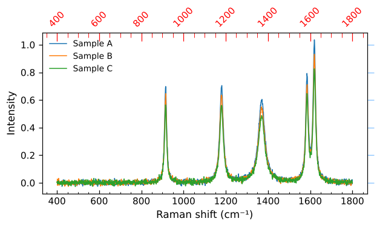

*Ticks set per side: x inward, y outward; long red ticks on top with rotated red numbers; right ticks blue and see-through; minor ticks on x only.*

Python:
```python
c.plot(box='closed', tick_sides=['bottom', 'top', 'left', 'right'], tick_label_sides=['bottom', 'top', 'left'], x_tick_direction='in', y_tick_direction='out', top_tick_length=9, top_tick_color='red', top_tick_label_color='red', top_tick_label_rotation=45, right_tick_color='cmyk(1, 0.5, 0, 0)', right_tick_alpha=0.5, right_tick_length=7, x_minor_ticks=True, minor_tick_count=3, grid=False)
```
Website (`/figure`), next to `"data"`:
```json
{"settings": {"box": "closed", "tick_sides": ["bottom", "top", "left", "right"], "tick_label_sides": ["bottom", "top", "left"], "x_tick_direction": "in", "y_tick_direction": "out", "top_tick_length": 9, "top_tick_color": "red", "top_tick_label_color": "red", "top_tick_label_rotation": 45, "right_tick_color": "cmyk(1, 0.5, 0, 0)", "right_tick_alpha": 0.5, "right_tick_length": 7, "x_minor_ticks": true, "minor_tick_count": 3, "grid": false}}
```


Notes:
- `tick_direction` "both" draws the tick through the box line, half in and half out.
- Minor ticks are shorter (0.55 x) and thinner (0.75 x) than the numbered
  ticks unless `minor_tick_length` is set; they take the colour, direction
  and transparency of their side.
- The distance of the numbers (`tick_label_pad`) is per axis, not per side.
- The old name `ticks` (for `tick_direction`) still works in saved styles.

## Grid

| Setting | Default | What it does |
|---|---|---|
| `grid` | true | grid lines: true or false |
| `grid_color` | "#b0b0b0" | grid line colour |
| `grid_style` | "-" | grid line type: "-", "--", ":" or "-." |
| `grid_width` | 0.6 | grid line width in points |
| `grid_alpha` | 0.4 | grid line transparency, 0 to 1 |

## Axis labels

General (both axes):

| Setting | Default | What it does |
|---|---|---|
| `label_size` | 11 | axis label size in points |
| `label_weight` | "normal" | "normal" or "bold": axis labels |
| `label_color` | "black" | axis label colour |
| `label_alpha` | 1.0 | axis label transparency, 0 to 1 |
| `label_italic` | false | axis labels in italics: true or false |
| `label_font` | *(not set)* | axis label font; None = font |
| `label_pad` | 4.0 | distance between the axis label and the tick labels, in points |

One axis; each falls back to the general setting:

| Setting | Default | What it does |
|---|---|---|
| `xlabel_size` | *(not set)* | label_size for the x axis label only; None = label_size |
| `xlabel_weight` | *(not set)* | label_weight for the x axis label only; None = label_weight |
| `xlabel_color` | *(not set)* | label_color for the x axis label only; None = label_color |
| `xlabel_alpha` | *(not set)* | label_alpha for the x axis label only; None = label_alpha |
| `xlabel_italic` | *(not set)* | label_italic for the x axis label only; None = label_italic |
| `xlabel_font` | *(not set)* | label_font for the x axis label only; None = label_font |
| `xlabel_pad` | *(not set)* | label_pad for the x axis label only; None = label_pad |
| `xlabel_rotation` | 0 | x axis label rotation in degrees |
| `ylabel_size` | *(not set)* | label_size for the y axis label only; None = label_size |
| `ylabel_weight` | *(not set)* | label_weight for the y axis label only; None = label_weight |
| `ylabel_color` | *(not set)* | label_color for the y axis label only; None = label_color |
| `ylabel_alpha` | *(not set)* | label_alpha for the y axis label only; None = label_alpha |
| `ylabel_italic` | *(not set)* | label_italic for the y axis label only; None = label_italic |
| `ylabel_font` | *(not set)* | label_font for the y axis label only; None = label_font |
| `ylabel_pad` | *(not set)* | label_pad for the y axis label only; None = label_pad |
| `ylabel_rotation` | 90 | y axis label rotation in degrees |

The label text itself is set with `xlabel` and `ylabel` (default: the units
of the data, else "x" and "Intensity").

## Title

The text is set with `title`.

| Setting | Default | What it does |
|---|---|---|
| `title_size` | 11 | title size in points |
| `title_weight` | *(not set)* | "normal" or "bold"; None = font_weight |
| `title_color` | "black" | title colour |
| `title_alpha` | 1.0 | title transparency, 0 to 1 |
| `title_italic` | false | title in italics: true or false |
| `title_font` | *(not set)* | title font; None = font |
| `title_location` | "center" | "left", "center" or "right" |
| `title_pad` | 6.0 | distance between the title and the plot, in points |

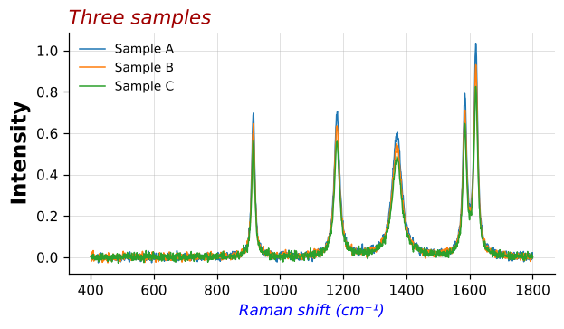

*Axis labels and title each set on their own: blue italic x label, large bold y label, title on the left in dark red italics.*

Python:
```python
c.plot(xlabel_color='blue', xlabel_italic=True, ylabel_size=15, ylabel_weight='bold', title='Three samples', title_location='left', title_color=[160, 0, 0], title_italic=True, title_size=14)
```
Website (`/figure`), next to `"data"`:
```json
{"title": "Three samples", "settings": {"xlabel_color": "blue", "xlabel_italic": true, "ylabel_size": 15, "ylabel_weight": "bold", "title_location": "left", "title_color": [160, 0, 0], "title_italic": true, "title_size": 14}}
```


## Legend

When and where:

| Setting | Default | What it does |
|---|---|---|
| `legend` | "auto" | True, False or "auto" (shown for 2 to 10 lines) |
| `legend_location` | "best" | e.g. "best", "upper right", "lower left"; outside the box: "outside right" (or "outside"), "outside top", "outside bottom" |
| `legend_position` | *(not set)* | exact place of the legend's corner as [x, y], 0 to 1 of the plot; overrides legend_location |
| `legend_columns` | 1 | number of columns of legend entries |
| `legend_order` | "normal" | "normal" (as drawn) or "reverse" |
| `legend_hide` | *(not set)* | legend entries to leave out: a list of spectrum numbers (0 = first) or names |

Entry text and heading:

| Setting | Default | What it does |
|---|---|---|
| `legend_size` | 9 | legend text size |
| `legend_weight` | "normal" | "normal" or "bold" |
| `legend_color` | "black" | legend text colour |
| `legend_alpha` | 1.0 | legend text transparency, 0 to 1 |
| `legend_italic` | false | legend text in italics: true or false |
| `legend_font` | *(not set)* | legend font; None = font |
| `legend_title` | *(not set)* | a heading above the legend entries |
| `legend_title_size` | *(not set)* | legend heading size; None = legend_size |
| `legend_title_weight` | "bold" | "normal" or "bold" |

Legend box:

| Setting | Default | What it does |
|---|---|---|
| `legend_box` | false | box around the legend: true or false |
| `legend_box_color` | "#cccccc" | legend box line colour |
| `legend_box_width` | 0.8 | legend box line width in points |
| `legend_box_alpha` | 1.0 | legend box line transparency, 0 to 1 |
| `legend_box_round` | true | rounded legend box corners: true or false |
| `legend_fill` | "white" | colour inside the legend box; "none" for no fill |
| `legend_fill_alpha` | 0.8 | legend fill transparency, 0 to 1 |
| `legend_shadow` | false | a shadow behind the legend box: true or false |

Entry layout:

| Setting | Default | What it does |
|---|---|---|
| `legend_line_length` | 2.0 | length of the line sample, in font sizes |
| `legend_marker_scale` | 1.0 | marker size in the legend relative to the plot |
| `legend_spacing` | 0.5 | vertical space between entries, in font sizes |

The names in the legend are the spectrum names, or `labels` (a list, one
per spectrum).

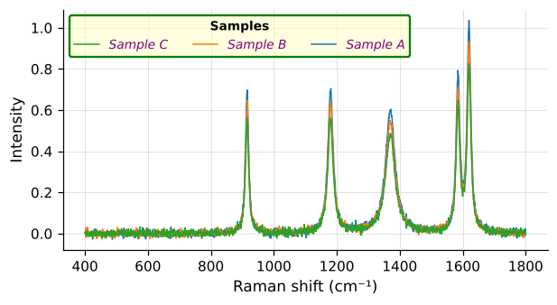

*Legend with a heading, three columns in reverse order, a green legend box and a light yellow, half see-through fill; italic purple entries.*

Python:
```python
c.plot(legend=True, legend_box=True, legend_title='Samples', legend_columns=3, legend_order='reverse', legend_box_color='green', legend_box_width=1.5, legend_fill='#ffffcc', legend_fill_alpha=0.6, legend_color='purple', legend_italic=True, legend_location='upper left')
```
Website (`/figure`), next to `"data"`:
```json
{"settings": {"legend": true, "legend_box": true, "legend_title": "Samples", "legend_columns": 3, "legend_order": "reverse", "legend_box_color": "green", "legend_box_width": 1.5, "legend_fill": "#ffffcc", "legend_fill_alpha": 0.6, "legend_color": "purple", "legend_italic": true, "legend_location": "upper left"}}
```


## Spectra (data lines)

Colours:

| Setting | Default | What it does |
|---|---|---|
| `colors` | "matplotlib" | colours of successive spectra: a name in PALETTES, a colour map name (e.g. "viridis", spread over the spectra) or a list of colours |
| `cmap` | "viridis" | colour map for many spectra (more than 10) and images |
| `line_color` | *(not set)* | spectrum line colour (or a list, one per spectrum); None = the colours of colors |

Palettes for `colors`: `matlab`, `matplotlib`, `colorblind`, `black`, `tab20`, `dark`; or any
matplotlib colour map name, such as `"viridis"`, `"plasma"` or `"coolwarm"`,
whose colours are spread evenly over the spectra (useful for a series, e.g.
increasing temperature). With more than 10 spectra the colours always come
from `cmap`, unless `line_color` is set.

Line:

| Setting | Default | What it does |
|---|---|---|
| `line_width` | 1.0 | spectrum line width in points (or a list) |
| `line_style` | "-" | spectrum line type: "-", "--", ":", "-." or "none" (markers only) (or a list) |
| `line_alpha` | *(not set)* | spectrum line transparency, 0 to 1 (or a list); None = solid, or 0.35 for more than 200 spectra |
| `line_format` | *(not set)* | MATLAB short code for marker, line type and colour together, e.g. "o-", "*--", ".", "r:" (or a list); replaces marker and line_style, and line_color when it has a colour letter |

Markers (the points on a line):

| Setting | Default | What it does |
|---|---|---|
| `marker` | *(not set)* | point marker: None, "o", ".", "s", "^", "v", "d", "x", "+", "*" ... (or a list) |
| `marker_size` | 3.0 | marker size in points (or a list) |
| `marker_color` | *(not set)* | marker edge colour (or a list); None = line colour |
| `marker_fill` | *(not set)* | colour inside the markers (or a list); "none" = hollow; None = marker_color |
| `marker_alpha` | *(not set)* | marker transparency, 0 to 1 (or a list); None = line_alpha |
| `marker_edge_width` | 1.0 | marker edge line width in points |
| `marker_every` | *(not set)* | a marker on every n-th point only, e.g. 20; None = on every point |

Emphasized spectra and fill:

| Setting | Default | What it does |
|---|---|---|
| `emphasize_width` | *(not set)* | line width of emphasized spectra (plot's emphasize) in points; None = 2 x line_width |
| `faded_alpha` | 0.3 | transparency of the other spectra when some are emphasized, 0 to 1 |
| `fill` | false | fill the area under each spectrum: true or false |
| `fill_color` | *(not set)* | fill colour; None = line colour |
| `fill_alpha` | 0.2 | fill transparency, 0 to 1 |

**One value or one per spectrum.** `line_color`, `line_width`, `line_style`, `line_alpha`, `line_format`, `marker`, `marker_size`, `marker_color`, `marker_fill`, `marker_alpha`
take either one value for every spectrum or a list with one value per
spectrum. A shorter list starts again from its beginning, so
`"line_style": ["-", "--"]` gives solid, dashed, solid, dashed ... One colour
written as numbers (`[0, 114, 189]`) is one colour, not a list.

**MATLAB codes** (`line_format`), exactly as in MATLAB's `plot(x, y, "o--")`.
A code joins up to three parts in any order: a line type, a marker and a
colour letter. A marker without a line type draws markers only (no line),
as in MATLAB.

| Part | Codes |
|---|---|
| line type | `-` solid, `--` dashed, `:` dotted, `-.` dash-dot |
| marker | `o` circle, `+` plus, `*` asterisk, `.` point, `x` cross, `s` square, `d` diamond, `^` `v` `>` `<` triangles, `p` five-pointed star, `h` hexagon, `_` `\|` short lines |
| colour | `r` red, `g` green, `b` blue, `c` cyan, `m` magenta, `y` yellow, `k` black, `w` white (MATLAB's pure colours) |

Examples: `"o-"` circles joined by a line; `"*--"` asterisks on a dashed
line; `"."` points only; `"r:"` red dotted line; `"ks-"` black squares on a
line. `line_format` replaces `marker` and `line_style`, and `line_color`
when it has a colour letter. `marker_every` is worth setting with markers:
a spectrum has hundreds of points, and a marker on each one hides the line.

**Emphasize** is an argument of `plot`, not a style setting:
`c.plot(emphasize=[0, 2])` or `emphasize=["Sample B"]` (numbers count from 0;
names are the spectrum names or `labels`). On the website it goes at the top
level of the body: `"emphasize": [1]`.

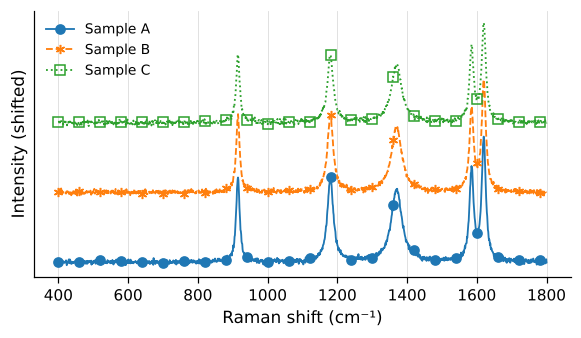

*One look per spectrum with MATLAB codes: circles and a line, asterisks and dashes, hollow squares and dots; a marker on every 60th point only (stacked).*

Python:
```python
c.plot(kind='stack', line_format=['o-', '*--', 's:'], marker_every=60, marker_size=6, marker_fill=[None, None, 'none'], line_width=1.2, legend=True)
```
Website (`/figure`), next to `"data"`:
```json
{"kind": "stack", "settings": {"line_format": ["o-", "*--", "s:"], "marker_every": 60, "marker_size": 6, "marker_fill": [null, null, "none"], "line_width": 1.2, "legend": true}}
```

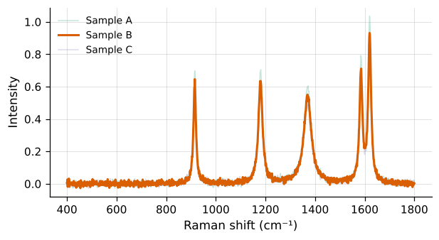

*Spectrum B emphasized: on top, thicker and solid, with the other two faded.*

Python:
```python
c.plot(emphasize=['Sample B'], colors='dark', faded_alpha=0.25, legend=True)
```
Website (`/figure`), next to `"data"`:
```json
{"emphasize": ["Sample B"], "settings": {"colors": "dark", "faded_alpha": 0.25, "legend": true}}
```

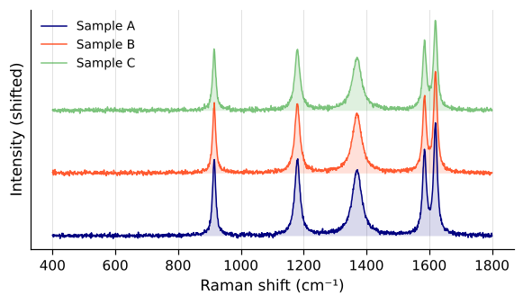

*Own colour per spectrum (one in CMYK), half see-through lines and a light fill under each line, down to its own zero (stacked).*

Python:
```python
c.plot(kind='stack', line_color=['navy', 'cmyk(0, 0.8, 1, 0)', '#2ca02c'], line_alpha=[1, 0.8, 0.6], fill=True, fill_alpha=0.15, legend=True)
```
Website (`/figure`), next to `"data"`:
```json
{"kind": "stack", "settings": {"line_color": ["navy", "cmyk(0, 0.8, 1, 0)", "#2ca02c"], "line_alpha": [1, 0.8, 0.6], "fill": true, "fill_alpha": 0.15, "legend": true}}
```


## Marks, peak labels and highlighted ranges

These are arguments of `plot` (`marks=`, `peaks=`, `highlight=`); on the
website they go at the top level of the body, next to `"data"`. Their look
is set by the settings below.

**Mark lines** (`marks=[1585, 1620]`, or `marks={1620: "C=C"}` with labels):

| Setting | Default | What it does |
|---|---|---|
| `mark_color` | "0.4" | mark line colour |
| `mark_style` | ":" | mark line type: "-", "--", ":" or "-." |
| `mark_width` | 0.9 | mark line width in points |
| `mark_alpha` | 1.0 | mark line transparency, 0 to 1 |
| `mark_span` | "full" | "full" (whole height), "peak" (from the bottom up to the spectrum) or "tick" (a short line above the spectrum) |

One mark can have its own look: `marks={1620: {"label": "C=C", "color": "red", "style": "--"}}`.
The keys are the setting names without `mark_`: `label`, `color`, `style`, `width`, `alpha`, `span`.

**Peak labels** (`peaks=5`: the 5 most prominent bands; or `peaks=[1000, 1600]`: those positions):

| Setting | Default | What it does |
|---|---|---|
| `peak_label_format` | "{:.0f}" | how the position is written, e.g. "{:.0f}" (1585) or "{:.1f} cm⁻¹" (1585.3 cm⁻¹) |
| `peak_sensitivity` | 0.02 | how far a band must stand out to be labelled, as a fraction of the data height |
| `peak_spectra` | "first" | "first" (bands of the first spectrum), "all", or a list of spectrum numbers |
| `peak_line` | false | a line from each band up to its label: true or false |
| `peak_line_color` | "0.4" | peak line colour |
| `peak_line_style` | "-" | peak line type: "-", "--", ":" or "-." |
| `peak_line_width` | 0.8 | peak line width in points |
| `peak_line_alpha` | 1.0 | peak line transparency, 0 to 1 |

**Highlighted ranges** (`highlight=[[1570, 1640]]`, or `highlight="spikes"` for the spikes removed by despike):

| Setting | Default | What it does |
|---|---|---|
| `highlight_color` | "tab:orange" | highlight fill colour |
| `highlight_alpha` | 0.15 | highlight fill transparency, 0 to 1 |
| `highlight_hatch` | *(not set)* | stripes in the highlight, for black and white print: "/", "\\", "x", "-", "/", "+", "." or "o" (doubled, e.g. "//", for denser stripes); None = no stripes |
| `highlight_edge_color` | *(not set)* | colour of the line around the highlight; None = no line |
| `highlight_edge_width` | 1.0 | width of the line around the highlight, in points |
| `highlight_edge_style` | "-" | line type around the highlight: "-", "--", ":" or "-." |
| `spike_color` | "tab:red" | fill colour of spikes shaded by highlight="spikes" and by compare |
| `spike_alpha` | 0.15 | spike fill transparency, 0 to 1 |

One range can have its own label and look:
`highlight=[{"range": [1570, 1640], "label": "G band", "color": "blue"}]`. The keys
are `range`, `label` and the setting names without `highlight_`:
`color`, `alpha`, `hatch`, `edge_color`, `edge_width`, `edge_style`.

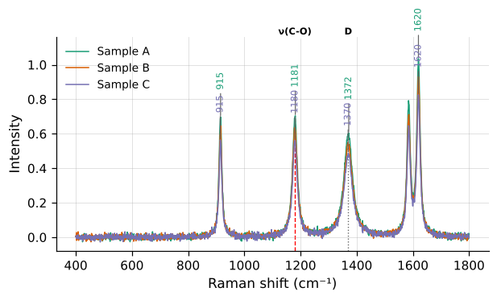

*Peak labels of the first and third spectrum in the colour of their line, with a line up to each label (labels that would overlap are moved apart); marks from the bottom up to the spectrum, one in red and dashed; mark labels in a box.*

Python:
```python
c.plot(peaks=4, marks={1180: {'label': 'ν(C-O)', 'color': 'red', 'style': '--'}, 1370: 'D'}, peak_spectra=[0, 2], peak_label_color='line', peak_line=True, peak_label_pad=22, mark_span='peak', mark_label_box=True, mark_label_rotation=0, mark_label_weight='bold', colors='dark')
```
Website (`/figure`), next to `"data"`:
```json
{"peaks": 4, "marks": {"1180": {"label": "ν(C-O)", "color": "red", "style": "--"}, "1370": "D"}, "settings": {"peak_spectra": [0, 2], "peak_label_color": "line", "peak_line": true, "peak_label_pad": 22, "mark_span": "peak", "mark_label_box": true, "mark_label_rotation": 0, "mark_label_weight": "bold", "colors": "dark"}}
```

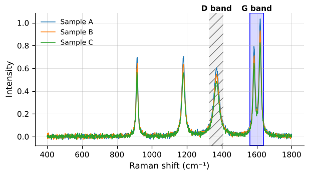

*Two highlighted ranges, each with its own label and look: a blue range with a solid line around it, and a striped range for black and white print.*

Python:
```python
c.plot(highlight=[{'range': [1560, 1640], 'label': 'G band', 'color': 'blue', 'edge_color': 'blue'}, {'range': [1330, 1410], 'label': 'D band', 'hatch': '//', 'color': '0.5', 'alpha': 0.1}], highlight_label_weight='bold', highlight_label_size=10)
```
Website (`/figure`), next to `"data"`:
```json
{"highlight": [{"range": [1560, 1640], "label": "G band", "color": "blue", "edge_color": "blue"}, {"range": [1330, 1410], "label": "D band", "hatch": "//", "color": "0.5", "alpha": 0.1}], "settings": {"highlight_label_weight": "bold", "highlight_label_size": 10}}
```


## Text on the plot

Mark labels (`C=C`), peak labels (`1585`) and highlight labels (`G band`)
each have the same settings, starting with `mark_label_`, `peak_label_` or
`highlight_label_`:

| Setting (after `mark_label_` ...) | Default: mark / peak / highlight label | What it does |
|---|---|---|
| `mark_label_color`, `peak_label_color`, `highlight_label_color` | "black" / "black" / "black" | label text colour; for peak labels also "line": the colour of its spectrum |
| `mark_label_alpha`, `peak_label_alpha`, `highlight_label_alpha` | 1.0 / 1.0 / 1.0 | label text transparency, 0 to 1 |
| `mark_label_size`, `peak_label_size`, `highlight_label_size` | *(not set)* / *(not set)* / *(not set)* | label text size in points; None = 0.75 x font_size |
| `mark_label_weight`, `peak_label_weight`, `highlight_label_weight` | *(not set)* / *(not set)* / *(not set)* | "normal" or "bold"; None = font_weight |
| `mark_label_italic`, `peak_label_italic`, `highlight_label_italic` | false / false / false | label in italics: true or false |
| `mark_label_font`, `peak_label_font`, `highlight_label_font` | *(not set)* / *(not set)* / *(not set)* | label font; None = font |
| `mark_label_rotation`, `peak_label_rotation`, `highlight_label_rotation` | 90 / 90 / 0 | label rotation in degrees, e.g. 0 or 90 |
| `mark_label_position`, `peak_label_position`, `highlight_label_position` | "top" / "peak" / "top" | "top" (just above the box) or "peak" (just above the spectrum) |
| `mark_label_pad`, `peak_label_pad`, `highlight_label_pad` | *(not set)* / *(not set)* / *(not set)* | distance between the label and what it sits on, in points; None = automatic |
| `mark_label_box`, `peak_label_box`, `highlight_label_box` | false / false / false | a box behind the label, so it stays readable over lines: true or false |
| `mark_label_box_color`, `peak_label_box_color`, `highlight_label_box_color` | "none" / "none" / "none" | label box line colour; "none" = no line |
| `mark_label_fill`, `peak_label_fill`, `highlight_label_fill` | "white" / "white" / "white" | colour inside the label box |
| `mark_label_fill_alpha`, `peak_label_fill_alpha`, `highlight_label_fill_alpha` | 0.8 / 0.8 / 0.8 | label box fill transparency, 0 to 1 |

| Setting | Default | What it does |
|---|---|---|
| `label_overlap` | "move" | "move" (labels that would overlap are moved apart) or "keep" (left where they are) |

Special characters: write them directly (cm⁻¹, ν(C=C), I₀, δ), or as math
text between dollar signs, e.g. `"$\nu_{as}$(CH$_2$)"` for ν with "as" below
and CH with a small 2.

## Scale and extra axes

| Setting | Default | What it does |
|---|---|---|
| `x_log` | false | logarithmic x scale: true or false |
| `y_log` | false | logarithmic y scale: true or false (values of 0 and below are not drawn) |

A second axis shows the same data in another unit. On top: the absolute
wavelength of each Raman shift for your laser (`"wavelength"`), or the x
values times a factor plus an offset (`"scale"`). On the right: the y values
times a factor plus an offset. Their ticks and numbers follow the `top_...`
and `right_...` tick settings (e.g. `top_tick_label_color`), their labels
the `xlabel_...` and `ylabel_...` settings.

| Setting | Default | What it does |
|---|---|---|
| `top_axis` | "none" | "none", "wavelength" (absolute wavelength in nm for the laser top_axis_laser) or "scale" (x times top_axis_scale plus top_axis_offset) |
| `top_axis_laser` | 532.0 | laser wavelength in nm, for top_axis "wavelength" |
| `top_axis_scale` | 1.0 | factor for top_axis "scale" |
| `top_axis_offset` | 0.0 | added after the factor, for top_axis "scale" |
| `top_axis_label` | *(not set)* | top axis label; None = "Wavelength (nm)", or the x label for "scale" |
| `right_axis` | "none" | "none" or "scale" (y times right_axis_scale plus right_axis_offset) |
| `right_axis_scale` | 1.0 | factor for right_axis "scale", e.g. 0.1 for counts per second at 10 s exposure |
| `right_axis_offset` | 0.0 | added after the factor, for right_axis "scale" |
| `right_axis_label` | *(not set)* | right axis label; None = the y label |

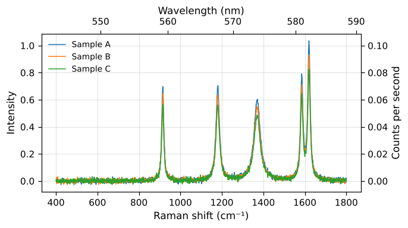

*A second x axis on top (absolute wavelength for a 532 nm laser) and a second y axis on the right (counts per second at 10 s exposure).*

Python:
```python
c.plot(top_axis='wavelength', top_axis_laser=532, right_axis='scale', right_axis_scale=0.1, right_axis_label='Counts per second', box='closed')
```
Website (`/figure`), next to `"data"`:
```json
{"settings": {"top_axis": "wavelength", "top_axis_laser": 532, "right_axis": "scale", "right_axis_scale": 0.1, "right_axis_label": "Counts per second", "box": "closed"}}
```


## Gaps where data was cut

After `cut` (removing a range such as the silicon band), the line would be
drawn straight across the gap. With `cut_marks` the line breaks there and
// marks on the box show the gap (also on the top line when the box is closed).

| Setting | Default | What it does |
|---|---|---|
| `cut_marks` | false | break the line where cut removed points, and mark the gap with // on the box: true or false |
| `cut_mark_size` | 8.0 | size of the // marks in points |
| `cut_mark_color` | *(not set)* | colour of the // marks; None = box_color |
| `cut_mark_width` | *(not set)* | line width of the // marks in points; None = box_width |

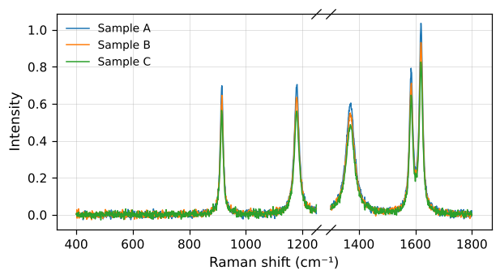

*The range 1250 to 1300 removed with cut: the lines break there and // marks show the gap on the box.*

Python:
```python
c.cut(1250, 1300).plot(cut_marks=True, box='closed')
```
Website (`/figure`), next to `"data"`:
```json
{"settings": {"cut_marks": true, "box": "closed"}}
```


## Line names and scale bar

Each spectrum's name can be written next to its line, with the legend, or
instead of it (`legend=False`): the two are set apart. A scale bar shows the
size of the y unit when the y numbers are hidden, as in stacked plots. When
both are on the same side, the bar stands past the names.

| Setting | Default | What it does |
|---|---|---|
| `line_names` | false | write each spectrum's name next to its line: true or false (the legend is set apart, by legend) |
| `line_name_position` | "right" | "right" or "left" end of the line |
| `line_name_color` | "line" | name colour; "line" = the colour of its spectrum |
| `line_name_alpha` | 1.0 | name transparency, 0 to 1 |
| `line_name_size` | *(not set)* | name size in points; None = legend_size |
| `line_name_weight` | *(not set)* | "normal" or "bold"; None = font_weight |
| `line_name_italic` | false | names in italics: true or false |
| `line_name_font` | *(not set)* | name font; None = font |
| `line_name_pad` | 3.0 | distance between the end of the line and its name, in points |

| Setting | Default | What it does |
|---|---|---|
| `scale_bar` | *(not set)* | height of a vertical bar in y units, e.g. 1000; None = no bar |
| `scale_bar_label` | *(not set)* | text next to the bar; None = the height and the y unit, e.g. "1000 counts" |
| `scale_bar_position` | "right" | "right" or "left" of the box |
| `scale_bar_color` | "black" | bar and text colour |
| `scale_bar_alpha` | 1.0 | bar and text transparency, 0 to 1 |
| `scale_bar_width` | 2.0 | bar line width in points |
| `scale_bar_label_size` | *(not set)* | text size in points; None = 0.75 x font_size |
| `scale_bar_label_weight` | *(not set)* | "normal" or "bold"; None = font_weight |
| `scale_bar_label_italic` | false | text in italics: true or false |
| `scale_bar_label_font` | *(not set)* | text font; None = font |

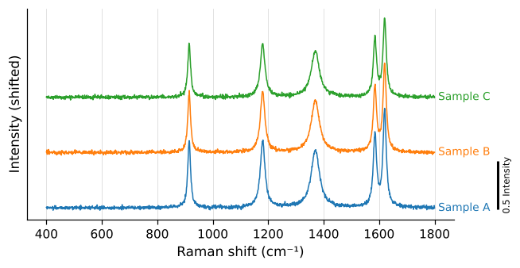

*Stacked spectra with each name next to its line (no legend) and a scale bar showing the size of 0.5 intensity units.*

Python:
```python
c.plot(kind='stack', line_names=True, legend=False, scale_bar=0.5)
```
Website (`/figure`), next to `"data"`:
```json
{"kind": "stack", "settings": {"line_names": true, "legend": false, "scale_bar": 0.5}}
```


## Mean with a band (kind "mean")

| Setting | Default | What it does |
|---|---|---|
| `mean_band` | "std" | "std" (±1 standard deviation), "2std", "minmax" (lowest to highest), "ci95" (95 % confidence of the mean) or "none" |
| `mean_band_color` | *(not set)* | band colour; None = line colour |
| `mean_band_alpha` | 0.25 | band transparency, 0 to 1 |

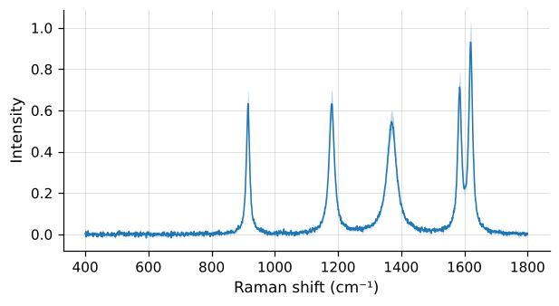

*The mean of the three spectra with a band from the lowest to the highest value.*

Python:
```python
c.plot(kind='mean', mean_band='minmax', mean_band_alpha=0.3)
```
Website (`/figure`), next to `"data"`:
```json
{"kind": "mean", "settings": {"mean_band": "minmax", "mean_band_alpha": 0.3}}
```


## Image of many spectra (kind "image")

| Setting | Default | What it does |
|---|---|---|
| `color_limits` | *(not set)* | intensity of the lowest and highest colour [lo, hi]; either may be None (automatic: the 1st and 99th percentile) |
| `colorbar` | true | colour bar next to the image: true or false |
| `colorbar_label` | *(not set)* | colour bar label; None = the y unit |
| `colorbar_ticks_at` | *(not set)* | colour bar tick positions, e.g. [0, 500, 1000]; None = automatic |
| `colorbar_length` | 1.0 | colour bar length relative to the plot height, 0 to 1 |
| `colorbar_fraction` | 0.15 | share of the plot width given to the colour bar (with its gap) |
| `image_y` | "number" | "number" (spectrum numbers) or "name" (spectrum names) on the y axis |

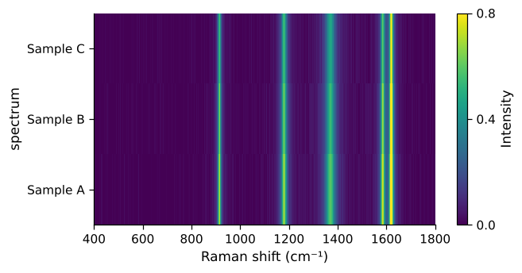

*The spectra as an image, with their names on the y axis, fixed colour limits and chosen colour bar ticks.*

Python:
```python
c.plot(kind='image', image_y='name', color_limits=[0, 0.8], colorbar_ticks_at=[0, 0.4, 0.8], colorbar_label='Intensity')
```
Website (`/figure`), next to `"data"`:
```json
{"kind": "image", "settings": {"image_y": "name", "color_limits": [0, 0.8], "colorbar_ticks_at": [0, 0.4, 0.8], "colorbar_label": "Intensity"}}
```


## Notes and arrows

Free text anywhere on the plot, an argument of `plot` (on the website at the
top level of the body): `notes=[{"text": "D band", "x": 1350, "y": 0.8}]`.
`x` and `y` are data values, or 0 to 1 of the box with `"coords": "axes"`.
`"arrow": [x, y]` draws an arrow from the note to that point (data values).
One note can change any of these for itself, with the names without
`note_`, e.g. `"color": "red"`:

| Setting | Default | What it does |
|---|---|---|
| `note_color` | "black" | note text colour |
| `note_alpha` | 1.0 | note text transparency, 0 to 1 |
| `note_size` | *(not set)* | note text size in points; None = font_size |
| `note_weight` | *(not set)* | "normal" or "bold"; None = font_weight |
| `note_italic` | false | note in italics: true or false |
| `note_font` | *(not set)* | note font; None = font |
| `note_rotation` | 0 | note rotation in degrees |
| `note_box` | false | a box behind the note: true or false |
| `note_box_color` | "none" | note box line colour; "none" = no line |
| `note_fill` | "white" | colour inside the note box |
| `note_fill_alpha` | 0.8 | note box fill transparency, 0 to 1 |
| `note_arrow_color` | "black" | arrow colour |
| `note_arrow_alpha` | 1.0 | arrow transparency, 0 to 1 |
| `note_arrow_width` | 1.0 | arrow line width in points |
| `note_arrow_style` | "-" | arrow line type: "-", "--", ":" or "-." |
| `note_arrow_head` | "->" | "->" open head, "-/>" filled head, or "-" no head |

## Inset (a zoomed view)

A small copy of the plot, zoomed on an x range, inside the box: an argument
of `plot`, `inset=[1550, 1650]` or `inset={"region": [1550, 1650],
"position": "upper left", "scale": 0.35, "lines": false}`. A legend at
`"best"` keeps clear of the inset.

| Setting | Default | What it does |
|---|---|---|
| `inset_position` | "upper right" | "upper left", "upper right", "lower left" or "lower right" |
| `inset_scale` | 0.4 | inset size relative to the plot, 0 to 1 |
| `inset_lines` | true | frame the zoomed range in the plot and join it to the inset: true or false |
| `inset_line_color` | "0.4" | frame and joining line colour |
| `inset_line_alpha` | 1.0 | frame and joining line transparency, 0 to 1 |
| `inset_line_width` | 0.8 | frame and joining line width in points |
| `inset_line_style` | "-" | frame and joining line type: "-", "--", ":" or "-." |
| `inset_tick_label_size` | *(not set)* | inset tick label size in points; None = 0.8 x tick_label_size |
| `inset_tick_count` | 3 | about how many numbered ticks on each inset axis; None = automatic |

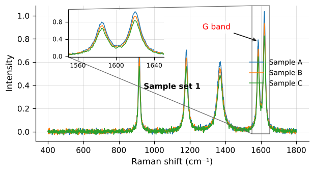

*A note in a box with an arrow to a band, a bold note placed by its share of the box, and an inset zoomed on 1550 to 1650 at the upper left.*

Python:
```python
c.plot(notes=[{'text': 'G band', 'x': 1350, 'y': 0.9, 'arrow': [1585, 0.78], 'color': 'red', 'box': True}, {'text': 'Sample set 1', 'x': 0.5, 'y': 0.4, 'coords': 'axes', 'weight': 'bold'}], inset={'region': [1550, 1650], 'position': 'upper left'}, inset_scale=0.35)
```
Website (`/figure`), next to `"data"`:
```json
{"notes": [{"text": "G band", "x": 1350, "y": 0.9, "arrow": [1585, 0.78], "color": "red", "box": true}, {"text": "Sample set 1", "x": 0.5, "y": 0.4, "coords": "axes", "weight": "bold"}], "inset": {"region": [1550, 1650], "position": "upper left"}, "settings": {"inset_scale": 0.35}}
```


## Panels (several plots in one figure)

`stk.panels` puts several plots in one figure, each with a letter. Every
entry is a Spectrum or collection, or a dict with `"data"`, any plot argument
(`"kind"`, `"title"`, `"peaks"` ...) and its own settings:

```python
stk.panels([c, {"data": c, "kind": "stack", "peaks": 3}, {"data": c, "kind": "mean"},
            {"data": c, "kind": "image"}], layout=[2, 2], size=(12, 7), save="figure.png")
```

`layout` is `[rows, columns]` (default one column for up to 3 panels, else
two columns); `share_x` / `share_y` give the panels one x (or y) range and
write the numbers only on the outer panels; `title` goes over the whole
figure; `"letter": "(z)"` (or `false`) in an entry replaces its letter. The
figure is `size` times the layout, so each panel has the size of one plot.
On the website: `{"panels": [{"data": ..., "kind": "stack", "settings": {...}}, ...],
"layout": [2, 2], "share_x": true}` in place of `"data"`.

| Setting | Default | What it does |
|---|---|---|
| `panel_letters` | true | a letter on each panel, (a), (b) ...: true or false |
| `panel_letter_format` | "({})" | how the letter is written: "({})" -> (a), "{})" -> a), "{}" -> a |
| `panel_letter_case` | "lower" | "lower" (a, b, c) or "upper" (A, B, C) |
| `panel_letter_position` | "outside" | "outside" (above the top left corner of the box) or "inside" (in the top left corner) |
| `panel_letter_size` | *(not set)* | letter size in points; None = 1.2 x font_size |
| `panel_letter_weight` | "bold" | "normal" or "bold" |
| `panel_letter_color` | "black" | letter colour |
| `panel_letter_alpha` | 1.0 | letter transparency, 0 to 1 |
| `panel_letter_italic` | false | letters in italics: true or false |
| `panel_letter_font` | *(not set)* | letter font; None = font |

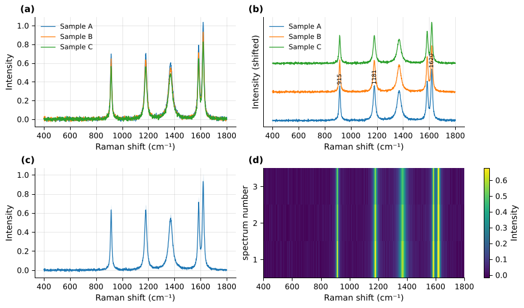

*Four panels: lines, stacked with peak labels, mean, and image.*

**Layout and sizes.** `layout` can also be text: rows split by `;`, one
letter per panel (in the order of the entries), the same letter in several
places for a panel across them, and `.` for an empty place: `"AA;BC"` is one
wide panel over two, `"AB;AC"` one tall panel beside two. `widths=[2, 1]`
and `heights=[1.3, 1]` give columns and rows their relative sizes (default all
equal). On the website: `"layout": "AA;BC", "widths": [2, 1]`.

**Shared parts.** Each of these is off by default, so a figure looks as
before unless you turn it on: `panel_legend` gives one legend for the whole
figure (each name once, so it suits panels that show the same spectra; the
legend settings still apply; on top it goes under the figure title); `panel_shared_labels` gives one x and/or y label for the
whole figure, with the text of `xlabel` / `ylabel` given to `panels`, else the
first panel's, styled by the `xlabel_...` / `ylabel_...` settings;
`panel_colorbar` gives all image panels one colour scale (`color_limits`,
else the 1st and 99th percentile of all of them) and one colour bar.

| Setting | Default | What it does |
|---|---|---|
| `panel_spacing` | 0.02 | extra space between panels, as a fraction of the figure (0 = only the room their labels need) |
| `panel_spacing_x` | *(not set)* | extra space between columns of panels; None = panel_spacing |
| `panel_spacing_y` | *(not set)* | extra space between rows of panels; None = panel_spacing |
| `panel_legend` | "each" | "each" (a legend in each panel, as set by legend) or one legend for the whole figure: "figure top", "figure bottom" or "figure right" |
| `panel_shared_labels` | false | one x label and one y label for the whole figure instead of one per panel: true, false, "x" or "y" (only that axis) |
| `panel_colorbar` | "each" | "each" (every image panel has its own colour bar and colour scale) or "shared" (one colour bar and one colour scale for all image panels) |

![The full range over two zooms (layout "AA;BC", heights [1.3, 1]), one legend on top and one y label.](plotting/panels_layout.png)

*The full range over two zooms (layout "AA;BC", heights [1.3, 1]), one legend on top and one y label.*

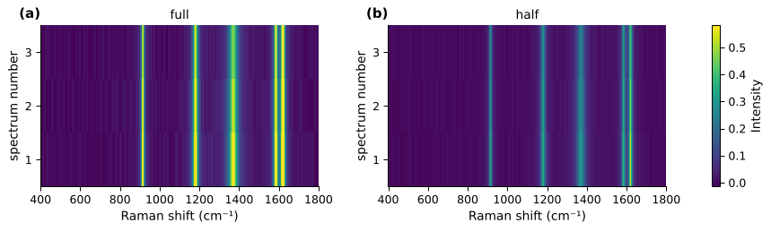

*Two image panels with one colour bar and one colour scale, and more space between the columns.*

**Before/after views as panels (kind "compare").** A panel can be the view
`stk.compare` draws: `{"data": before, "after": after, "kind": "compare"}`
with optional `"index"` (which spectrum, by number or name), `"region"`,
`"removed"` and `"labels"`, as in `stk.compare`. The "removed" strip hangs
under its panel, so the boxes of a column still line up and `share_x` works
across ordinary and compare panels. The default title is the step and its
method, e.g. "baseline (airpls)" (`stk.compare` on its own figure also lists
the settings). On the website the panel is the same, with `"after"` as data.

```python
raw = stk.load("CV10-4M.xlsx"); clean = raw.despike()
stk.panels([{"data": raw, "after": clean, "kind": "compare", "index": 3, "region": [1550, 1750]},
            {"data": clean, "after": clean.baseline(), "kind": "compare", "index": 3}], layout=[1, 2])
```

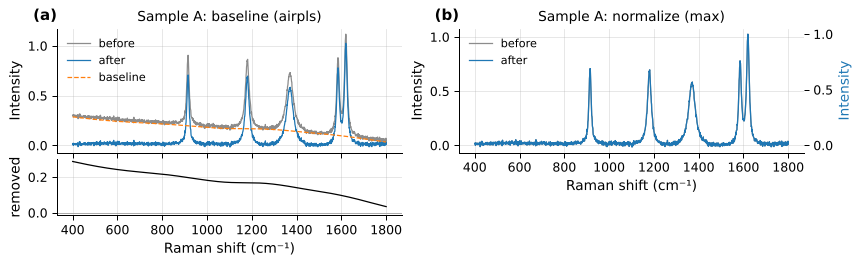

*Two before/after panels: the baseline removed (with what was removed under it), then normalized (own scale on the right).*

## Groups (which sample each spectrum is)

Groups are stored with the data, one label per spectrum (`c.groups`), and
follow the spectra through every step. Set them in one of five ways:

| Way | Python | Website (`/groups`) |
|---|---|---|
| spectrum numbers or names | `c.set_groups({"CV": range(0, 14), "MB": range(14, 19)})` | `"groups": {"CV": [0, 1, ...], "MB": [...]}` |
| one label per spectrum | `c.set_groups(["CV", "CV", "MB", ...])` | `"groups": ["CV", "CV", "MB", ...]` |
| from the names | `c.set_groups("name")`: "CV 1", "CV_2" → CV | `"groups": "name"` |
| your own rule | `c.set_groups(pattern=r"^(\w+)_")`: the part in brackets | `"pattern": "^(\\w+)_"` |
| the file | `stk.combine("CV.txt", "MB.txt", groups="file")` | (several files: later) |

`rename={"CV10-4M": "CV"}` renames groups. Nothing is guessed silently:
`c.suggest_groups()` (website: `/groups` with only `"data"`) proposes groups
with the reason, for the user to confirm, and names that only number the
spectra ("Spectrum 1", "Spot2") give no proposal. `c.by_group()` gives one
collection per group.

In plots: `color_by="group"` gives one colour and one legend entry per group
(`labels` then name the groups); with `kind="mean"`, one mean per group;
`stk.panels(c, by="group", kind="stack")` gives one panel per group, titled
with its name and number of spectra. Spectra in no group show as "(no group)".
On the website: `"color_by": "group"` next to `"data"`, or `"by": "group"`
with `"data"` and `"kind"` for panels; the data carries `"groups"`.

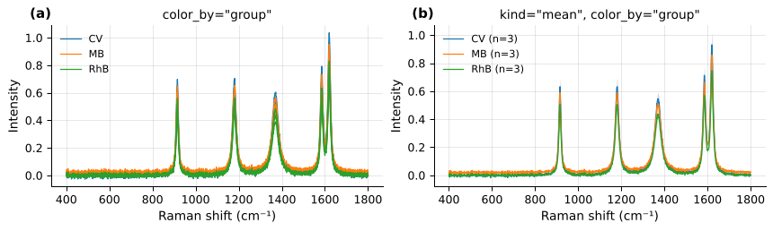

*Nine spectra in three groups: one colour per group, and one mean per group.*

## Reference lines at zero

| Setting | Default | What it does |
|---|---|---|
| `zero_lines` | *(not set)* | lines marking zero: None (none), "x" (horizontal line at y = 0), "y" (vertical line at x = 0) or "both" |
| `zero_line_style` | "--" | zero line type: "-", "--", ":" or "-." |
| `zero_line_width` | 1.0 | zero line width in points |
| `zero_line_color` | "black" | zero line colour |
| `zero_line_alpha` | 1.0 | zero line transparency, 0 to 1 |

## Saving

| Setting | Default | What it does |
|---|---|---|
| `tight` | true | cut the white space around the figure when saving: true or false (false keeps the exact figure size) |
| `dpi` | 300 | dots per inch for png, tiff and jpg |
| `format` | "png" | file type when the name has no extension: png, tiff, jpg, pdf, svg, eps |
| `color_mode` | "rgb" | "rgb" or "cmyk" (cmyk only for tiff and jpg) |

Fonts: a font that is not installed is replaced by a similar one. Python
gives a warning; the website's answer has an `X-Warning` header naming it.
